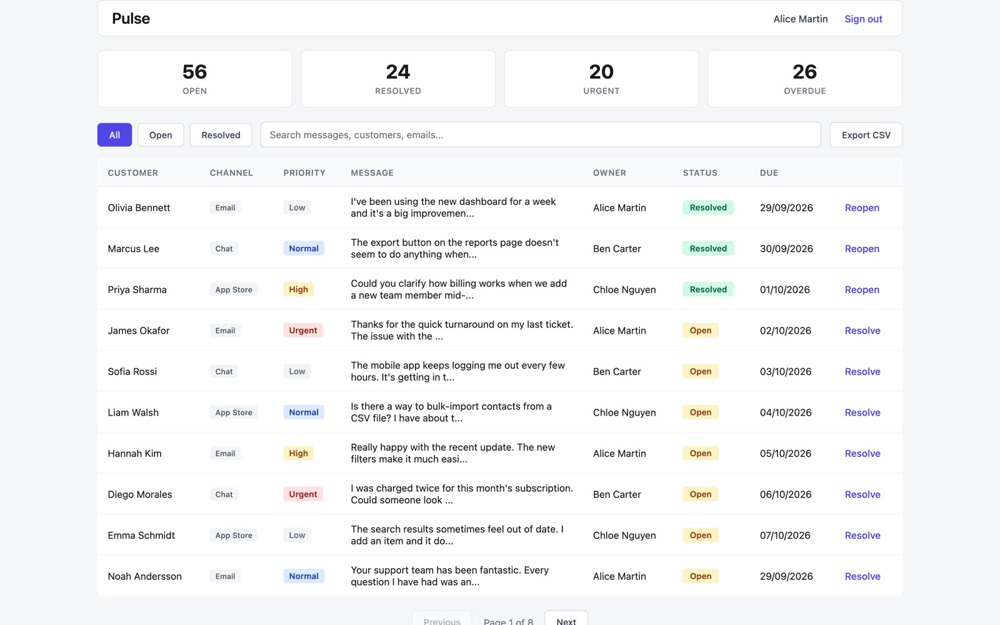
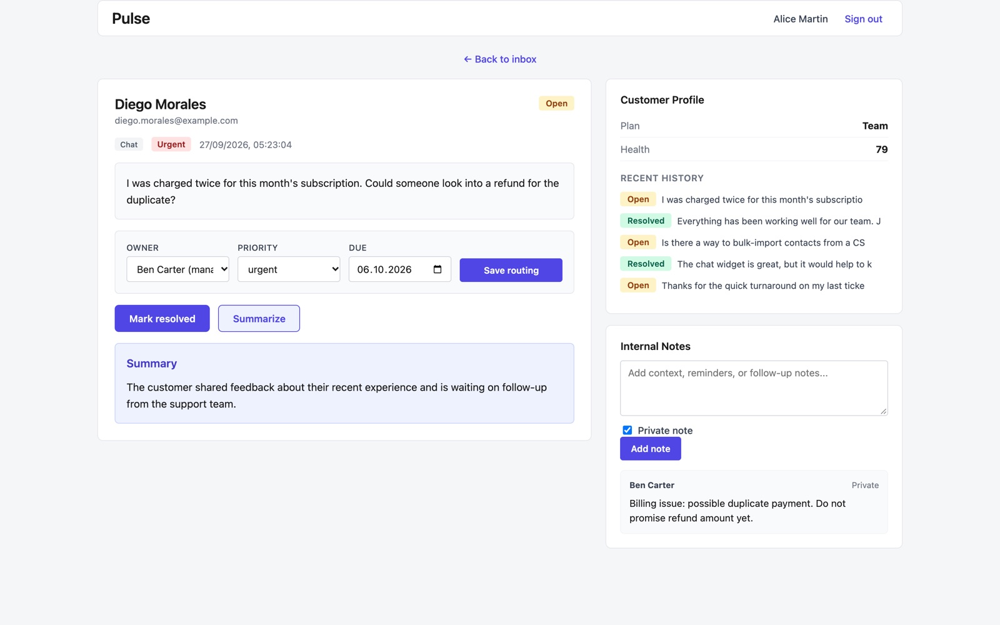

# Pulse

A customer-feedback workspace for support teams. Feedback arrives through email, chat and app-store reviews; Pulse puts it in one inbox so the team can triage it, route it to the right person and follow up on time.

**[Live demo](https://bechirboujelbene.github.io/pulse/)**: runs in the browser with sample data, so changes reset on reload and summaries are not generated by a model.




## Features

- **Inbox** with live counts (open, resolved, urgent, overdue), status filters, search and pagination
- **Routing:** owner, priority and due date per item
- **Customer profile** with plan, health score and recent history
- **Internal notes**, private or shared with the team
- **AI summary** of any message; the model key stays on the server
- **CSV export** of the current view

## How it is built

| Part | Technology |
|---|---|
| Web app | React, TypeScript, Vite |
| API | Node.js, Express, TypeScript, split into route modules, middleware and services |
| Database | SQLite (`better-sqlite3`) with parameterised queries |
| Auth | JWT sessions verified on every request, bcrypt password hashing |
| Tests | 28 API tests with Vitest and Supertest |

**Security and quality choices**
- Every query is parameterised; no request value is ever put into SQL text.
- Tokens are verified with the server secret (`JWT_SECRET`), never just decoded, and never accepted from the query string.
- User content (messages, notes, summaries) is rendered as text, never as HTML.
- CSV export escapes values that a spreadsheet would treat as formulas.
- The language-model key is read only on the server; the browser never sees it.

## Requirements

- Node 20+
- npm

## Setup

1. Install dependencies (installs both the server and web packages):

   ```bash
   npm install
   ```

2. Create the environment files from the examples:

   ```bash
   cp server/.env.example server/.env
   cp web/.env.example web/.env
   ```

   The defaults run the app fully offline: the Summarize feature uses a built-in placeholder
   summarizer (`FAKE_LLM=true`), so no API key is required.

3. Seed the database with sample users, customers, and feedback:

   ```bash
   npm run seed
   ```

4. Start the API and the web app together:

   ```bash
   npm run dev
   ```

   - API: http://localhost:4000
   - Web: http://localhost:5173

Open the web app in your browser and sign in.

## Test login

- **Email:** `alice@pulse.test`
- **Password:** `password123`

## Project layout

- `server/` — Node + Express + TypeScript API backed by SQLite (`better-sqlite3`).
- `web/` — React + TypeScript single-page app built with Vite.
- `web/src/demo.ts` — demo mode for the static build: answers the API calls in the browser from the same sample data the seed script uses (`server/src/seed-data.ts`).

## Optional: live summaries

To use a real model for the Summarize feature, set the following in `server/.env`:

```bash
FAKE_LLM=false
OPENAI_API_KEY=sk-...
```
